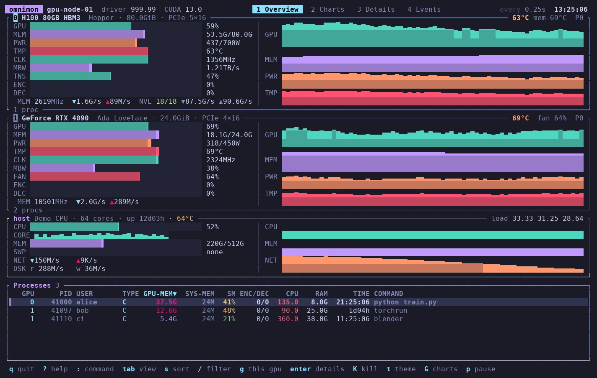
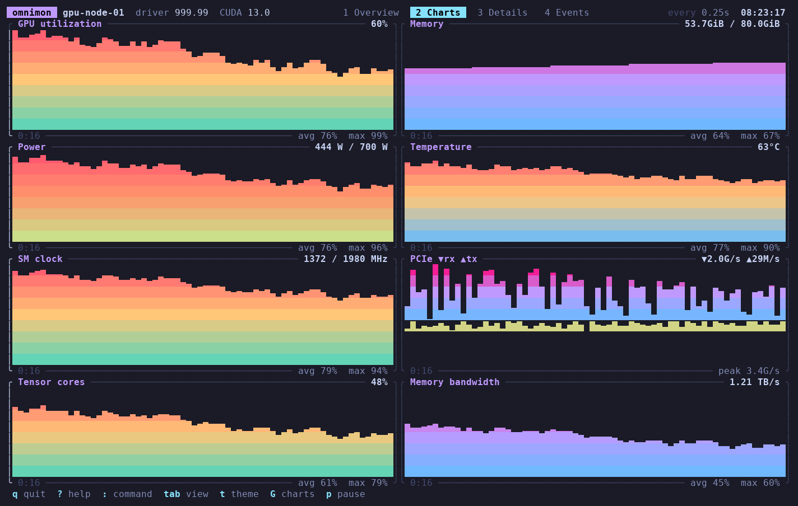
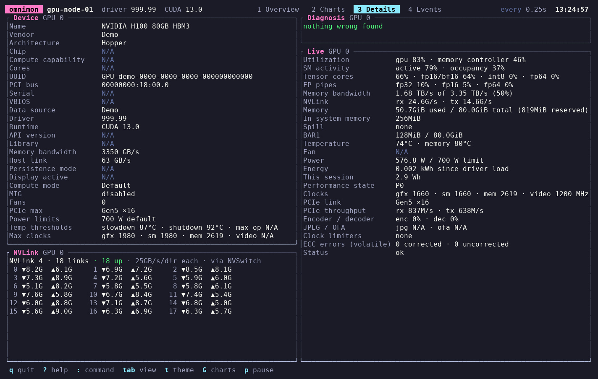
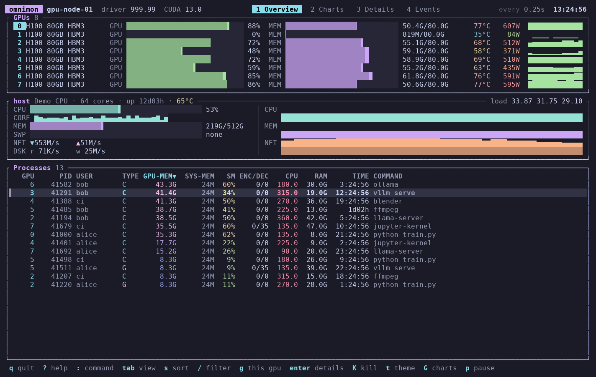
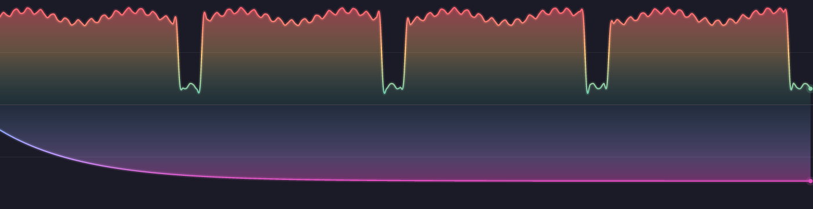

# omnimon

A terminal monitor for GPUs, the processes using them and the machine around
them. One self-contained binary for Linux, Windows and macOS that keeps
working where other monitors give up: Docker, Kubernetes, WSL2, Windows
(WDDM) and Apple Silicon without sudo. It also tells you when a workload is
spilling out of VRAM.



## Why another one

| | nvtop | nvitop | **omnimon** |
|---|---|---|---|
| Single binary, no runtime deps | ✗ (ncurses, libdrm) | ✗ (Python) | ✓ |
| Looks for NVML outside the loader path (WSL, k8s operator, GKE) | ✗ | ✗ | ✓ |
| Processes inside containers (host PID namespace) | blank rows | `N/A` rows | checked + translated¹ |
| Windows native, per-process GPU memory under WDDM | ✗ | `N/A` | ✓ |
| AMD / Intel on Linux | ✓ | ✗ | experimental¹ |
| AMD / Intel on Windows | ✗ | ✗ | ✓¹ |
| Apple Silicon, no sudo, per-process GPU % | partial | ✗ | ✓ |
| Measured VRAM spill per process | ✗ | ✗ | ✓ |
| Rewind through recent history, across restarts | ✗ | ✗ | ✓ |
| Headless recorder with replay | ✗ | ✗ | ✓ |
| Prometheus / JSON exporter built in | ✗ | separate package | ✓ |

Comparison as of 2026; corrections welcome. ¹ Not yet verified on that
hardware; see [Platforms](#platforms-and-data-sources).

## Features

- **Overview**: a card per GPU with bars (util, memory, power, temperature,
  clocks, memory bandwidth, fan, encoder/decoder) and history strips for
  utilization, memory, power and temperature. On 8+ GPU boxes the cards
  collapse to one line each. Borders turn red on spill, thermal throttling,
  power brake, ECC errors or a lost GPU.
- **Peaks between samples** (NVIDIA): the driver records power every ~20 ms
  and utilization every ~200 ms. Each tick reads everything since the last
  one, so power is the true average over the interval (from the energy
  counter) and the bars and charts shade the highest reading above it. An
  idle RTX 4090 swings between 4 W and 18 W within one second, and a 1 s
  poll would show just one of those values. Also exported as `power_min`,
  `power_max`, `util_gpu_min`, `util_gpu_max` in JSON and
  `gpu_power_max_watts` / `gpu_utilization_max_percent` in Prometheus.
- **Host**: the same layout for the machine: CPU with per-core load, memory,
  swap, network and disk throughput, CPU temperature, load.
- **Processes**: GPU memory, memory spilled to system RAM (`SYS-MEM`), SM %,
  enc/dec, CPU, RAM, runtime, user, command. Sort, filter, tag and signal.
  `Enter` opens the process: parent chain, children, exe, cwd, GPU-relevant
  environment (`CUDA_VISIBLE_DEVICES`, `HIP_*`, `NCCL_*`...), and its history.
  `a` adds the busiest CPU-only processes (top 80 by CPU and 20 by RAM), so
  a data loader pegging the CPU or a runaway build shows up next to the GPU
  jobs it is starving.
- **Charts**: utilization, memory, power, temperature, SM clock, PCIe rx/tx;
  on Hopper and newer also tensor-core activity and real memory bandwidth.
  Real anti-aliased pixel plots in terminals that support images (kitty,
  WezTerm, Ghostty, iTerm2, Windows Terminal, VS Code with
  `terminal.integrated.enableImages`), solid block charts everywhere else.
  Five color schemes for bars and charts (`L`): mono (the default, one
  color per metric), rainbow, heat (color follows the value), outline,
  minimal (grey until something runs hot).
- **NVLink and MIG** (NVIDIA data-center GPUs): links up/down, traffic and
  errors per link, peers (GPU or NVSwitch); MIG partitions with memory, SMs,
  processes (`GPU/instance` in the table) and, on Hopper+, utilization.
  Implemented against NVIDIA's documented API; not yet verified on hardware
  ([help verify](docs/hw-test.md)).
- **Unit activity** (NVIDIA Hopper+, via GPM): SM active/occupancy, tensor
  cores by precision, FP pipes, DRAM bandwidth in TB/s, NVLink traffic. Same
  status as NVLink and MIG.
- **Details**: everything the driver knows, plus a **diagnosis** in plain
  language: spill, thermal/power limits, a PCIe link running below its
  maximum under load, low clocks, a CPU-bound feeder process, a GPU holding
  memory while idle.
- **Events**: timeline of spills, clock limiters, errors, process start/exit.
- **Rewind**: `<` `>` step back and forth through recent history (`{` `}` 60
  samples, `0` back to live). The whole screen shows that moment: cards,
  processes, spill state. The UI records while it runs, so the last hour
  survives restarts.
- **Recorder and replay**: `--record` samples and records without the UI
  (`--serve --record` does both); `--replay` opens a recording in the full
  UI, positioned at its start: `--replay` (the latest hour), `--replay 2h`
  (two hours ago), `--replay 14:00`, `--replay "2026-11-10 14:00..15:30"`.
  `--replay ... --json` prints the recorded snapshots as JSON lines, in the
  same format as `--json --watch`. `--replay WHEN --once` sums a range up
  (utilization and power mean/p95/max, busy time, energy, memory and
  temperature peaks, time spent clock-limited or spilling, the busiest
  processes, event counts); `--replay A --diff B` puts two ranges side by
  side, e.g. last night's run against tonight's (`--json` for either). Recordings keep 7 days (`--keep 48h`,
  at most 1 GB) and take about 2 MB per hour on a desktop with ~50 GPU
  processes: each file holds a minute-by-minute full snapshot and only what
  changed in between, gzip-compressed (`.rec` files are valid gzip, of JSON
  lines). The UI and a recorder can run together: one writes, the other
  takes over when it stops. To record from login: on Windows
  `scripts/recorder-windows.ps1` (a logon task, no window, no admin); on
  Linux a systemd user service, `ExecStart=/usr/local/bin/omnimon --record`
  in `~/.config/systemd/user/omnimon-recorder.service` with
  `WantedBy=default.target`, then `systemctl --user enable --now
  omnimon-recorder`.
- **Tuning**: `w` sets the selected GPU's power limit (needs admin/root).
- **Command palette** (`:`): `theme nord`, `sort cpu`, `filter gpu:0 spill`,
  `hide host`, `show procs`, `procs all`, `charts blocks`, `interval 2`, `gpu 1`,
  `view events`.
- **Headless**: `--once`, `--json`, `--json --watch` (JSON lines), `--serve`
  (Prometheus `/metrics` + `/json`), `--diagnose`.
- **Remote**: run `--serve 0.0.0.0:9465` on a headless box and
  `--connect box` from your laptop for the full UI (read-only). There is no
  authentication and `/json` includes process command lines and user names,
  so keep it on a trusted network (the default address is localhost only).
- **Alerts**: `alert_command` in the config runs on critical events (spill,
  thermal, errors) with the event in `OMNIMON_EVENT` / `OMNIMON_KIND` /
  `OMNIMON_SEVERITY` / `OMNIMON_GPU` / `OMNIMON_PID` / `OMNIMON_TIME`, e.g.
  `notify-send` or `curl` to a webhook. It runs under `sh -c` (Windows:
  `cmd /C`, so `%OMNIMON_EVENT%`).
- **Containers and energy**: container/pod id per process (from cgroups);
  session energy per GPU and each process's estimated share
  (`price_per_kwh` in the config adds cost).
- Six themes (`t`), truecolor with automatic 256-color fallback, mouse
  support, rebindable keys, settings persist. `--demo N` simulates N GPUs.

| | |
|---|---|
|  |  |
|  |  |

## Spillover

When a workload outgrows VRAM, the driver or runtime puts the overflow in
system memory, and every access crosses PCIe at a fraction of VRAM
bandwidth. Nothing crashes; bandwidth-bound work just gets slower. (Windows'
NVIDIA "sysmem fallback" does this silently; so does a model partly offloaded
to the CPU.)

omnimon reports **measured** spill only: GPU allocations living in system
memory (Windows WDDM "Shared Usage", AMD GTT) while VRAM is nearly full
(95%+). They show per process in `SYS-MEM` with a `!`, as a total on the GPU
card, and as a timeline event when a process starts spilling.

Shared memory alone isn't counted: the desktop compositor, pinned staging
buffers and WSL's VM worker all keep allocations there with VRAM to spare.
VRAM above 98% full is shown as information ("pressure"), not as an alarm.

## Platforms and data sources

| Platform | Source | Status |
|---|---|---|
| NVIDIA on Windows 11, WSL2, Docker Desktop | NVML, loaded at runtime | verified (RTX 4090) |
| NVIDIA on native Linux, Kubernetes | NVML, loaded at runtime | same code; not yet verified |
| NVIDIA per-process memory under WDDM | Windows GPU performance counters | verified |
| AMD / Intel (and NVIDIA without NVML) on Windows | D3DKMT + GPU performance counters | verified on NVIDIA only |
| Apple Silicon | IOKit, IOReport, HID sensors (no sudo) | verified (M4 Pro) |
| AMD on Linux | amdgpu sysfs/hwmon + DRM fdinfo | experimental (simulated-sysfs tests) |
| Intel on Linux | i915/xe sysfs/hwmon + DRM fdinfo | experimental (simulated-sysfs tests) |
| NVIDIA NVLink, MIG, GPM | NVML | experimental (not yet verified on hardware) |

**Containers**: NVML reports *host* PIDs. omnimon checks that a process actually
holds a GPU device before trusting its PID, translates host PIDs where the
kernel leaks them, matches the rest to local GPU processes, and shows what it
can't map as `h<pid>` instead of dropping or mislabeling it, so you can't
signal the wrong process (tested against a simulated `/proc`). **WSL2**: the driver exposes no process list (even
`nvidia-smi` shows none); work done inside WSL shows up on the Windows side as
`vmwp.exe`. Details per backend: [docs/backends.md](docs/backends.md).

## Install

Linux and macOS:

```sh
curl -fsSL https://github.com/sorbet-ai/omnimon/releases/latest/download/install.sh | sh
```

Windows (PowerShell):

```powershell
irm https://github.com/sorbet-ai/omnimon/releases/latest/download/install.ps1 | iex
```

The scripts pick the right binary for the OS and CPU, check it against the
release's `SHA256SUMS`, and put it in `~/.local/bin` (`/usr/local/bin` as
root) or `%LOCALAPPDATA%\Programs\omnimon`. `OMNIMON_VERSION` and
`OMNIMON_INSTALL_DIR` override the version and location.

Or with a package manager:

```sh
brew install sorbet-ai/tap/omnimon                       # macOS, Linux
scoop bucket add sorbet-ai https://github.com/sorbet-ai/scoop-bucket
scoop install omnimon                                     # Windows
cargo binstall omnimon                                    # prebuilt, via cargo-binstall
cargo install omnimon                                     # from source (Rust 1.91+)
```

Prebuilt binaries for Linux (x86_64, aarch64), Windows (x64) and macOS
(Apple Silicon, Intel) are attached to each
[release](https://github.com/sorbet-ai/omnimon/releases).

Building from a checkout: `cargo build --release`, or
`scripts/build-linux.sh` for portable Linux binaries (needs Docker).

The Linux release binary only needs glibc 2.17+ (tested back to CentOS 7). It
isn't static musl on purpose: a static binary can't `dlopen` the glibc-linked
NVIDIA library. The Windows release binary links the C runtime statically.

In Docker: `docker run --gpus all ...` (NVML is mounted when
`NVIDIA_DRIVER_CAPABILITIES` includes `utility`, the default). Add
`--pid=host` to see processes from other containers.

## Usage

```
omnimon                     interactive (-i SECONDS sets the refresh rate)
omnimon --readonly          no signals or tuning
omnimon --once              one-shot summary with diagnosis
omnimon --json [--watch]    snapshot / JSON lines (schema in report.rs)
omnimon --serve [ADDR]      Prometheus exporter (default 127.0.0.1:9465)
omnimon --connect HOST      watch another machine running --serve (read-only)
omnimon --record            record without the UI (--keep 7d, --recordings DIR)
omnimon --replay [WHEN]     look at a recording: 2h, 14:00, "2026-11-10 14:00..15:00"
omnimon --replay A --once   sum up a recorded range (--diff B: compare two)
omnimon --diagnose          what was detected, and why things are missing
omnimon --demo 8            8 simulated GPUs
omnimon --graphics sixel    force a graphics protocol (auto|kitty|sixel|iterm2|off)
omnimon --look heat         chart colors (mono|rainbow|heat|outline|minimal)
omnimon --theme nord        color theme; --no-color for plain output
```

Keys (press `?` for the live list): `1-4`/`Tab` views, `←→` GPU, `↑↓`
select, `s` sort, `/` filter, `:` command, `Enter` process details, `space`
tag, `a` all processes, `K` signal, `w` tune, `<` `>` rewind, `0` live, `t` theme, `G` chart
style, `L` chart colors, `+ -` refresh rate, `p` pause, `q` quit.

Filter syntax: free text plus `gpu:0`, `user:alice`, `pid:1234`,
`type:c|g|cpu`, `spill`, all ANDed.

Config (`~/.config/omnimon/config.json`, `%APPDATA%\omnimon` on Windows) is
written on exit. Hand-edit it to rebind keys, turn off recording from the
UI, or change how much is kept:

```json
{ "keys": { "kill": ["x", "f9"], "quit": ["q"] }, "hidden": ["host"],
  "record_history": false, "record_keep": "3d", "record_max_mb": 500 }
```

Recordings (including process command lines and user names) go to
`recordings/<host>/` in the platform state directory:
`~/.local/state/omnimon`, `~/Library/Application Support/omnimon` on macOS,
`%LOCALAPPDATA%\omnimon` on Windows.

Environment: `OMNIMON_NVML_PATH` (explicit NVML library), `OMNIMON_THEME`,
`OMNIMON_CONFIG`, `OMNIMON_STATE_DIR` (recordings location), `OMNIMON_COLOR=256`,
`OMNIMON_LOG=debug`.

## Architecture

```
src/
  main.rs          CLI and mode dispatch
  brand.rs         app name, env-var helpers, metric namespace
  model.rs         vendor-neutral data model; also the JSON wire format
  fmt.rs           number/byte/rate formatting
  logging.rs       log capture (shown in the UI instead of on the terminal)
  backend/         one module per data source behind the `Backend` trait
    nvml/          NVIDIA: hand-rolled, runtime-loaded NVML bindings
                   (links.rs NVLink, mig.rs MIG partitions)
    apple.rs       Apple Silicon: IOKit, IOReport, HID
    wddm.rs        Windows, any vendor: D3DKMT + performance counters
    amd.rs         AMD on Linux: sysfs/hwmon
    intel.rs       Intel on Linux: i915/xe sysfs/hwmon
    sysfs.rs       shared sysfs/hwmon helpers
    drm_fdinfo.rs  per-process usage for any DRM driver
    demo.rs        simulated GPUs (and host, for screenshots)
  os/              OS plumbing behind cfg-free facades
    pidmap.rs      driver PID -> local PID (containers), tested on a fake /proc
    windows.rs     WDDM counters, adapter enumeration
  collector.rs     samples all backends + host into a Snapshot; sampler thread
  host.rs          CPU/RAM/net/disk, process join, process details, signals
  spill.rs         spill detection
  diagnose.rs      "why is it slow?" findings
  events.rs        event timeline from consecutive snapshots (typed kinds)
  alerts.rs        alert hook: runs a command for notable events
  report.rs        --once / --json / --diagnose; JsonOut schema
  serve.rs         --serve exporter (Prometheus + JSON)
  remote.rs        --connect: a remote --serve as a snapshot source
  recording/       --record / --replay: compact on-disk format (delta.rs:
                   field-level deltas), writer with lock and retention, reader
  config.rs        preferences, config/state directories
  ui/              ratatui TUI: state + input (mod.rs, input.rs, filter.rs),
                   procview.rs (process list filter/sort/selection),
                   store.rs (live + rewind snapshots, history, events,
                   recording), views (overview, procs, charts,
                   details, timeline, popups), gfx.rs (pixel/block/braille
                   charts), themes
```

Adding a vendor means implementing `Backend` (static `GpuInfo`, then a
`GpuSample` per tick; optionally `apply` for settings) and adding a probe in
`backend::detect`. Anything a vendor can't report stays `None` and the UI
hides it or shows N/A.

## Development

- `cargo test`. Some tests (AMD, Intel, fdinfo, PID mapping) only build on
  Linux; elsewhere run them in Docker:
  `docker run --rm -v $PWD:/io -w /io messense/cargo-zigbuild cargo test`.
- `cargo test -- --ignored nvml` runs against a real NVIDIA GPU (it re-applies
  the current power limit, which changes nothing).
- `scripts/screenshots.sh` regenerates `docs/img` from `--demo` (Linux or
  WSL with tmux and Python + Pillow, after `scripts/build-linux.sh`).
- `scripts/tui-shot.sh` runs the Linux binary in a detached tmux session and
  dumps the screen; `scripts/ansi2png.py` renders a capture to PNG.
- `scripts/package.sh VERSION [--publish]` (maintainer tool): Homebrew,
  Scoop, winget and AUR manifests from a release's checksums.
- `scripts/mac-sync.sh` (maintainer tool): copies the tree to a Mac over SSH
  and builds there (`MAC=user@host`).

Contributions and hardware reports are welcome, especially for the
experimental backends; see [docs/hw-test.md](docs/hw-test.md).

## License

MIT
