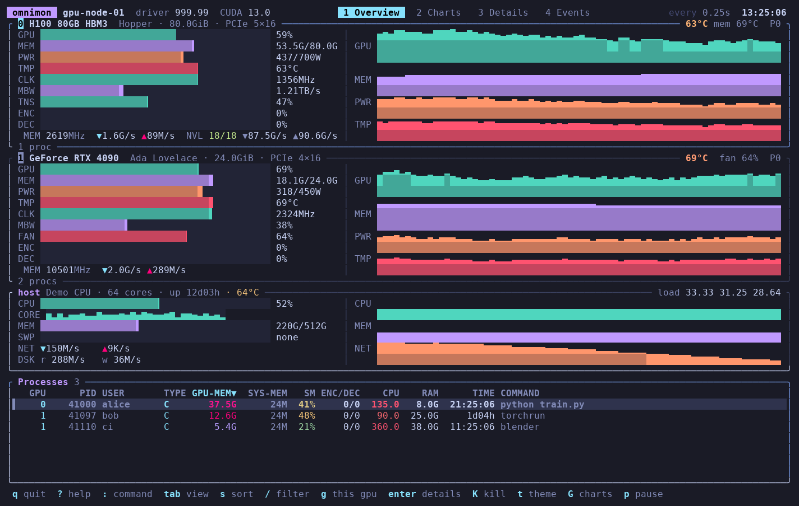
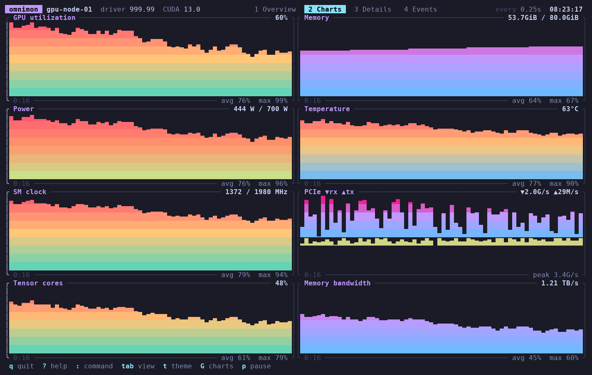
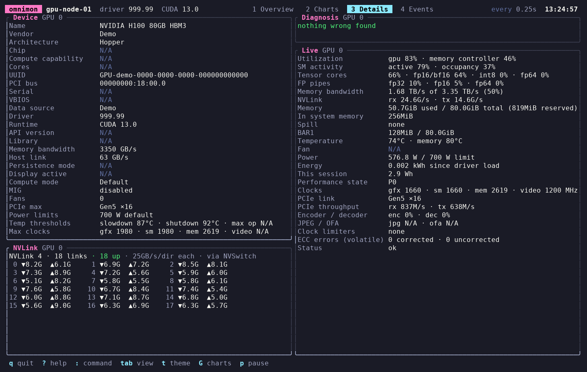
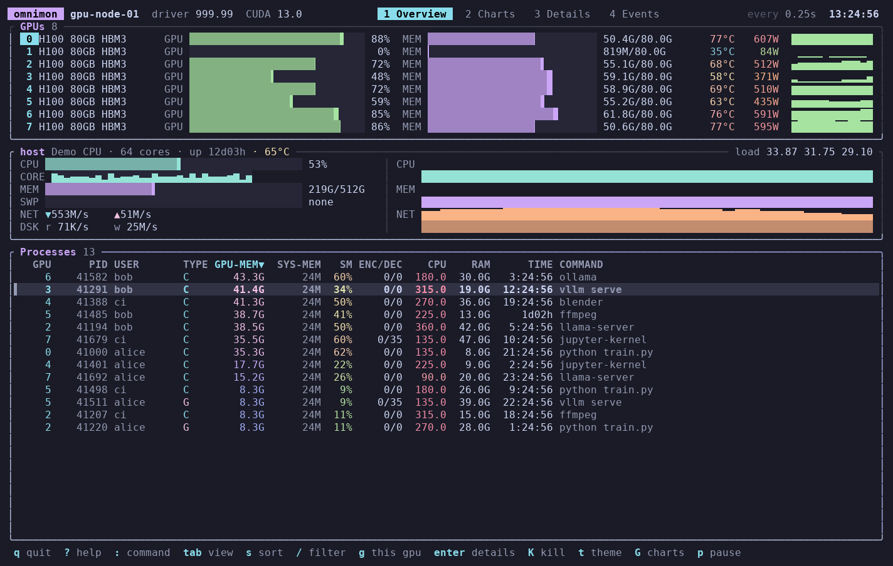
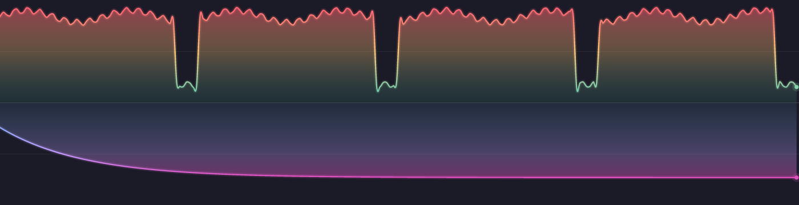

# nvtui

A fast, good-looking terminal monitor for GPUs, the processes using them and
the machine around them. One self-contained binary for Linux, Windows and
macOS that keeps working where other monitors give up: Docker, Kubernetes,
WSL2, Windows (WDDM) and Apple Silicon without sudo. It also tells you when a
workload is spilling out of VRAM.



## Why another one

| | nvtop | nvitop | **nvtui** |
|---|---|---|---|
| Single binary, no runtime deps | ✗ (ncurses, libdrm) | ✗ (Python) | ✓ |
| Finds NVML outside the loader path (WSL, k8s operator, GKE) | ✗ | ✗ | ✓ |
| Correct processes inside containers (host PID namespace) | blank rows | `N/A` rows | verified + translated |
| Windows native, per-process GPU memory under WDDM | ✗ | `N/A` | ✓ |
| AMD / Intel on Windows | ✗ | ✗ | ✓ |
| Apple Silicon, no sudo, per-process GPU % | partial | ✗ | ✓ |
| Measured VRAM spill per process, with slowdown estimate | ✗ | ✗ | ✓ |
| Rewind through the last hour, across restarts | ✗ | ✗ | ✓ |
| Prometheus / JSON exporter built in | ✗ | separate package | ✓ |

## Features

- **Overview**: a card per GPU with gradient bars (util, memory, power,
  temperature, clocks, memory bandwidth, fan, encoder/decoder) and a mirrored
  history chart (utilization up, memory down). On 8+ GPU boxes the cards
  collapse to one line each. Borders turn red on spill, thermal throttling,
  power brake, ECC errors or a lost GPU.
- **Host**: per-core CPU heat strip, memory, swap, network and disk throughput,
  CPU temperature, load.
- **Processes**: GPU memory, memory spilled to system RAM (`SYS-MEM`), SM %,
  enc/dec, CPU, RAM, runtime, user, command. Sort, filter, tag and signal.
  `Enter` opens the process: parent chain, children, exe, cwd, GPU-relevant
  environment (`CUDA_VISIBLE_DEVICES`, `HIP_*`, `NCCL_*`...), and its history.
- **Charts**: utilization, memory, power, temperature, SM clock, PCIe rx/tx.
  Real anti-aliased pixel plots in terminals that support images (kitty,
  WezTerm, Ghostty, iTerm2, Windows Terminal, VS Code with
  `terminal.integrated.enableImages`), solid block charts everywhere else.
- **Details**: everything the driver knows, plus a **diagnosis** in plain
  language: spill, thermal/power limits, a PCIe link running below its
  maximum under load, low clocks, a CPU-bound feeder process, a GPU holding
  memory while idle.
- **Events**: timeline of spills, clock limiters, errors, process start/exit.
- **Rewind**: `<` `>` step back and forth through recent history (`{` `}` a
  minute, `0` back to live). The whole screen shows that moment: cards,
  processes, spill state. History is kept on disk and survives restarts.
- **Tuning**: `w` sets the selected GPU's power limit (needs admin/root).
- **Command palette** (`:`): `theme nord`, `sort cpu`, `filter gpu:0 spill`,
  `hide host`, `show procs`, `charts blocks`, `interval 2`, `gpu 1`, `view events`.
- **Headless**: `--once`, `--json`, `--json --watch` (JSON lines), `--serve`
  (Prometheus `/metrics` + `/json`), `--diagnose`.
- **Remote**: run `--serve 0.0.0.0:9465` on a headless box and
  `--connect box` from your laptop for the full UI (read-only; no auth, so
  keep it on a trusted network).
- **Alerts**: `alert_command` in the config runs on critical events (spill,
  thermal, errors) with the event in `NVTUI_EVENT` / `NVTUI_KIND` /
  `NVTUI_SEVERITY` / `NVTUI_GPU` / `NVTUI_PID`, e.g. `notify-send` or `curl`
  to a webhook. It runs under `sh -c` (Windows: `cmd /C`, so `%NVTUI_EVENT%`).
- **Containers and energy**: container/pod id per process (from cgroups);
  session energy per GPU and each process's estimated share
  (`price_per_kwh` in the config adds cost).
- Six themes (`t`), truecolor with automatic 256-color fallback, mouse
  support, rebindable keys, settings persist. `--demo N` simulates N GPUs.

| | |
|---|---|
|  |  |
|  |  |

## Spillover

When a workload outgrows VRAM, the driver or runtime puts the overflow in
system memory, and every access crosses PCIe at a fraction of VRAM
bandwidth. Nothing crashes; it just gets several times slower. (Windows'
NVIDIA "sysmem fallback" does this silently; so does a model partly offloaded
to the CPU.)

nvtui reports **measured** spill only:

- per process: GPU allocations living in system memory (Windows WDDM "Shared
  Usage", AMD GTT), shown in `SYS-MEM` with a `!` and in the process popup;
- per GPU: total spilled bytes and an estimate of the slowdown for
  bandwidth-bound work, `1 / ((1-f) + f · VRAM bandwidth / PCIe bandwidth)`,
  from the card's real memory bus and link;
- a timeline event when a process starts spilling.

VRAM above 98% full is shown as information ("pressure"), not as an alarm.
Desktop processes keep a little shared memory normally; small amounts only
count as spill while VRAM is under pressure.

## Platforms and data sources

| Platform | Source | Status |
|---|---|---|
| NVIDIA, Linux / Windows / WSL2 / containers | NVML, loaded at runtime | verified (RTX 4090) |
| NVIDIA per-process memory under WDDM | Windows GPU performance counters | verified |
| AMD / Intel (and NVIDIA without NVML) on Windows | D3DKMT + GPU performance counters | verified on NVIDIA; vendor-neutral |
| Apple Silicon | IOKit, IOReport, HID sensors (no sudo) | verified (M4 Pro) |
| AMD on Linux | amdgpu sysfs/hwmon + DRM fdinfo | experimental (fake-sysfs tests) |
| Intel on Linux | i915/xe sysfs/hwmon + DRM fdinfo | experimental (fake-sysfs tests) |

**Containers**: NVML reports *host* PIDs. nvtui checks that a process actually
holds a GPU device before trusting its PID, translates host PIDs where the
kernel leaks them, matches the rest to local GPU processes, and shows what it
can't map as `h<pid>` instead of dropping or mislabeling it, so you can't
signal the wrong process. **WSL2**: the driver exposes no process list (even
`nvidia-smi` shows none); work done inside WSL shows up on the Windows side as
`vmwp.exe`. Details per backend: [docs/backends.md](docs/backends.md).

## Install / build

```sh
cargo build --release                 # native
scripts/build-linux.sh                # portable Linux x86_64 + aarch64 (glibc >= 2.17) via Docker + cargo-zigbuild
scripts/build-windows.sh              # Windows release into dist/
```

The Linux binary only needs glibc 2.17+ (tested back to CentOS 7). It isn't
static musl on purpose: a static binary can't `dlopen` the glibc-linked
NVIDIA library. The Windows binary links the C runtime statically.

In Docker: `docker run --gpus all ...` (NVML is mounted when
`NVIDIA_DRIVER_CAPABILITIES` includes `utility`, the default). Add
`--pid=host` to see processes from other containers.

## Usage

```
nvtui                     interactive
nvtui --once              one-shot summary with diagnosis
nvtui --json [--watch]    snapshot / JSON lines (schema in report.rs)
nvtui --serve [ADDR]      Prometheus exporter (default 127.0.0.1:9465)
nvtui --connect HOST      watch another machine running --serve (read-only)
nvtui --diagnose          what was detected, and why things are missing
nvtui --demo 8            8 simulated GPUs
nvtui --graphics sixel    force a graphics protocol (auto|kitty|sixel|iterm2|off)
```

Keys (press `?` for the live list): `1-4`/`Tab` views, `←→` GPU, `↑↓`
select, `s` sort, `/` filter, `:` command, `Enter` process details, `space`
tag, `K` signal, `w` tune, `<` `>` rewind, `0` live, `t` theme, `G` chart
style, `+ -` refresh rate, `p` pause, `q` quit.

Filter syntax: free text plus `gpu:0`, `user:alice`, `pid:1234`,
`type:c|g`, `spill`, all ANDed.

Config (`~/.config/nvtui/config.json`, `%APPDATA%\nvtui` on Windows) is
written on exit. Hand-edit it to rebind keys:

```json
{ "keys": { "kill": ["x", "f9"], "quit": ["q"] }, "hidden": ["host"] }
```

Environment: `NVTUI_NVML_PATH` (explicit NVML library), `NVTUI_THEME`,
`NVTUI_CONFIG`, `NVTUI_STATE_DIR` (history location), `NVTUI_COLOR=256`,
`NVTUI_LOG=debug`. History lives in the platform state directory
(`~/.local/state/nvtui`, `%LOCALAPPDATA%\nvtui`).

## Renaming the app

The name lives in one place: `name` in `Cargo.toml`. The binary, UI title,
env-var prefix, config and state directories, Prometheus metric namespace and
build scripts all derive from it (`src/brand.rs`; pin `METRIC_NS` there to
keep dashboard metric names stable across a rename).

## Architecture

```
src/
  main.rs          CLI and mode dispatch
  brand.rs         app name, env-var helpers, metric namespace
  model.rs         vendor-neutral data model; also the JSON wire format
  backend/         one module per data source behind the `Backend` trait
    nvml/          NVIDIA: hand-rolled, runtime-loaded NVML bindings
    apple.rs       Apple Silicon: IOKit, IOReport, HID
    wddm.rs        Windows, any vendor: D3DKMT + performance counters
    amd.rs         AMD on Linux: sysfs/hwmon
    intel.rs       Intel on Linux: i915/xe sysfs/hwmon
    drm_fdinfo.rs  per-process usage for any DRM driver
    demo.rs        simulated GPUs
  os/              OS plumbing behind cfg-free facades
    pidmap.rs      driver PID -> local PID (containers), tested on a fake /proc
    windows.rs     WDDM counters, adapter enumeration
  collector.rs     samples all backends + host into a Snapshot; sampler thread
  host.rs          CPU/RAM/net/disk, process join, process details, signals
  spill.rs         spill detection and slowdown estimate
  diagnose.rs      "why is it slow?" findings
  events.rs        event timeline from consecutive snapshots (typed kinds)
  alerts.rs        alert hook: runs a command for notable events
  report.rs        --once / --json / --diagnose; JsonOut schema
  serve.rs         --serve exporter (Prometheus + JSON)
  remote.rs        --connect: a remote --serve as a snapshot source
  config.rs        preferences, config/state directories
  ui/              ratatui TUI: state + input (mod.rs, input.rs, filter.rs),
                   procview.rs (process list filter/sort/selection),
                   store.rs (live + rewind snapshots, history, events,
                   recording via recorder.rs), views (overview, procs, charts,
                   details, timeline, popups), gfx.rs (pixel/block/braille
                   charts), themes
```

Adding a vendor means implementing `Backend` (static `GpuInfo`, then a
`GpuSample` per tick; optionally `apply` for settings) and adding a probe in
`backend::detect`. Anything a vendor can't report stays `None` and the UI
hides it or shows N/A.

## Development

- `cargo test` (Linux-only tests for AMD, Intel, fdinfo run in Docker:
  `docker run --rm -v $PWD:/io -w /io messense/cargo-zigbuild cargo test`).
  Hardware tests: `cargo test -- --ignored` on a machine with an NVIDIA GPU.
- `scripts/tui-shot.sh` runs the Linux binary in a detached tmux session and
  dumps the screen; `scripts/ansi2png.py` renders a capture to PNG.
- `scripts/mac-sync.sh` builds and runs on a Mac over SSH.
